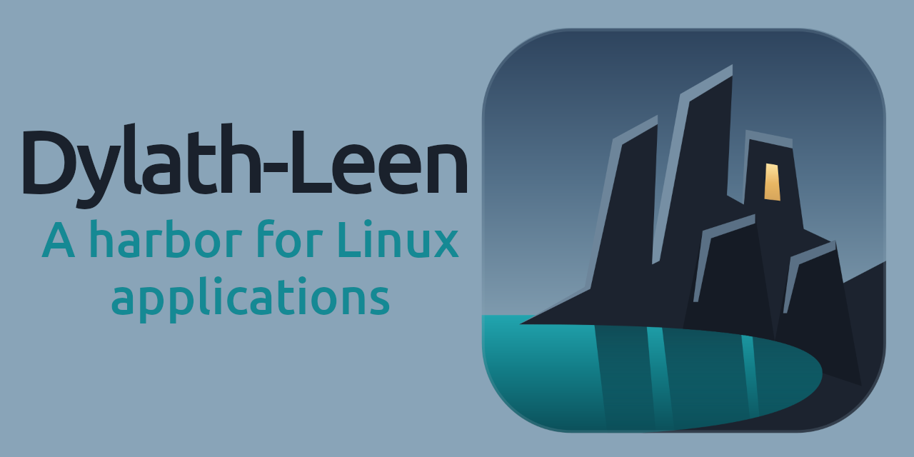

[Русская версия](README.ru.md) · [Changes](CHANGELOG.md)

Dylath-Leen is an independently modified fork of [bauh](https://github.com/vinifmor/bauh) by Vinícius Moreira. Its native Python / Qt 5 desktop manages Flatpak, Snap, AppImage, binaries installed with [marcosnils/bin](https://github.com/marcosnils/bin), and third-party DEBs managed by [deb-get](https://github.com/wimpysworld/deb-get). APT and dpkg are outside its catalogue.

## Install and run

From a source checkout run `./packaging/build-deb` (requires dpkg-deb, tar and standard GNU tools). Install the resulting file with `sudo apt install ./dist/dylathleen_0.6.0~test1-1_all.deb`. Open **Dylath-Leen** from the desktop menu or run `dylathleen` as your regular user. For a downloaded DEB, run apt in its directory with `./` before its filename. No pip, virtual environment or AppImage launcher is needed.

Refresh to list installed software, search by name, select updates and review the confirmation before applying them. Use `dylathleen --offline` for local inventory, `dylathleen --settings` for format settings and `dylathleen-tray` for notifications. System Flatpak transactions use the system's authorization policy. Snap operations require snapd and may prompt for sudo. Configuration, installed AppImage data and caches use separate dylathleen directories. Existing bauh-managed AppImages are not automatically imported.

## System service

The DEB includes the on-demand dylathleend service. Refresh checks system bin and deb-get alongside the user managers. An unavailable source leaves its last known data visible. The timer checks hourly by default. [Timer, credentials, system directories and security review](docs/system-service.md)

## bin

Install [marcosnils/bin](https://github.com/marcosnils/bin/releases) v0.29.4 or later and make it available in `PATH` or in one of the configured bin directories. Open **Actions → Install from a repository (bin)** and enter the HTTPS repository URL. The dialog supports GitHub, Codeberg and GitLab release attachments for `owner/repo` URLs. Pick a release (the latest stable one is selected initially), a file for your OS and architecture, and, when prompted, the executable inside the archive. Sources, checksums and signatures are filtered out. GitLab assets exposed only through the package registry or release descriptions can be installed with the CLI.

Choose a user installation (`~/.local/bin` by default) or a system installation (`/usr/local/bin`). The table shows both scopes and exposes pin and unpin in the row menu. System entries appear automatically. Release downloads run as the desktop user and dylathleend commits system changes after Polkit authorization.

Edit the directories in **Settings → bin** to move the files registered in each changed scope. The migration updates absolute paths and the CLI's default directory. A destination conflict or a locally replaced binary stops that scope's migration. If you change both fields, each scope is saved independently. Add the destination to your shell's `PATH` to launch commands by name after moving them.

The normal update view uses `bin update --dry-run`. Selecting an older release leaves it eligible for updates. Use **Pin version** to hold it. If bin cannot reuse the previous asset or archive member, Dylath-Leen asks for a new choice for the supported repository hosts. For other existing providers, update selection is limited to what bin can resolve without a prompt. Use the native CLI for provider-specific commands and unsupported archive layouts. Keep Dylath-Leen and the bin CLI from modifying the same registry concurrently.

## deb-get

Install deb-get 0.4.7 separately. Open **Actions → Browse the deb-get catalogue**, or enter `deb-get` in the main search box. The manager supports installation, selective and bulk upgrades, reinstall, remove and purge for deb-get applications. Use **Refresh deb-get catalogue** on a fresh installation. APT/PPA candidates are labelled as local index data, and package transactions present a plan for confirmation. Use **Manage local deb-get recipes** or **Generate a deb-get recipe from releases** to work with local Bash recipes. [Details and manual checks](docs/deb-get.md)

## Launch bin and deb-get applications

Right-click an installed application or open its row menu and select **Configure launch**. Set the executable and its arguments, then select **Automatic**, **Graphical application**, **Run in a terminal** or **Launch disabled**. Automatic mode follows a suitable desktop file and opens a terminal when it declares `Terminal=true`. Choose a desktop file if several match. Without a suitable desktop file, select a mode yourself.

The bin dialog starts with the registered executable path. For deb-get, the executable field offers the candidates found among installed files and accepts a custom path. Launch settings are stored per user and survive application updates. Changing a bin installation directory also moves the launch profiles for that scope. Every launch uses your desktop user account, including for system installations.

The **?** window for installed deb-get applications shows the paths from dpkg, detected executables, the command with arguments and available desktop files. Use the eye icon to expand file lists and the copy buttons to copy paths or the command.

## Flatpak updates

The inventory joins installed deployments to the remote update list by user/system scope, origin and typed ref (including architecture and branch). Flatpak supplies the installed version, active commit, target commit and the remote catalogue's release label. A changed commit with an unchanged reported version is a build update. An absent label, a failed catalogue refresh or a numerically older catalogue version yields an unknown target. A catalogue label is publisher metadata and can lag the actual commit. The displayed preview describes the last refresh. Flatpak resolves the transaction again when applying it.

## Formats and platform targets

Flatpak 1.12 or newer is required. Configure a Flatpak remote for the desired installation. Snap needs a running snapd. The inherited AppImage backend targets x86-64 and uses upstream catalogues. Network services, catalogue availability and desktop authorization affect individual transactions.

CI targets Ubuntu 22.04, 24.04, 26.04 and Debian 12, 13. Run `/usr/bin/python3 -m unittest discover` with the system dependencies installed. The build accepts SOURCE_DATE_EPOCH and uses a fixed default for repeatable archives. CI produces downloadable build artifacts. See [implementation notes](docs/iteration-1.md) for limitations and outstanding work.

## License

The original Zlib notice by Vinícius Moreira is preserved. Dylath-Leen changes by Konkere use the same [license](LICENSE).
